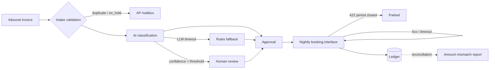

# Error analysis: invoice data flow

> Generated by `python -m analysis.error_analysis` from the demo database (300 generated invoice documents, Aug-Oct 2026). Do not edit by hand; CI regenerates this file and fails if it differs. All data is synthetic.

## Summary

| # | Error class | Count | Amount affected | Root cause | Fix |
|---|---|---|---|---|---|
| 1 | Transient API failures (5xx, timeouts) on booking | 45 invoices | - | Accounting API unavailable / slow (injected faults) | Retry with backoff (in place, 31 recovered) |
| 2 | Timeout after the server committed | 5 retries | - | Response lost after booking was written | Idempotent booking endpoint (in place, no double booking) |
| 3 | Booking rejected: posting period closed (HTTP 422) | 14 invoices | 98,563.87 EUR | Posting date = invoice date, approval finished after the period close (day 5) | Post into the open period with service date, alert AP instead of parking silently |
| 4 | Ledger amount differs from invoice gross | 14 entries | 7,553.59 EUR | Interface mapping books net instead of gross for Nordwind Logistik | Fix mapping, correction bookings, nightly ledger-vs-invoice reconciliation |
| 5 | Header amounts inconsistent (net + tax != gross) | 5 documents | 179.28 EUR (abs. diff) | OCR misread or vendor error | Kept on hold by intake validation, request corrected invoice |
| 6 | Duplicates caught at intake | 8 documents | 20,371.48 EUR | Vendor re-sent the document (4 with re-formatted number) | Normalised vendor + number check (in place) |
| 7 | Suspected duplicates missed by intake | 4 pairs | 33,969.40 EUR approved twice | Re-issued with a new number, same amount | Fuzzy check (vendor + amount + date window) as warning in the approval |
| 8 | Other validation holds (negative amount, currency) | 3 + 2 | - | Credit note sent as invoice; USD document | Detect credit notes; FX handling or manual route |
| 9 | LLM endpoint timeouts | 7 calls | - | Model endpoint outage (2 simulated days) | Rules fallback (in place); more cases go to human review |

## 1. Failed API calls

57 of 558 logged calls failed.

| Endpoint | Calls | OK | Timeouts | 5xx | 4xx |
|---|---|---|---|---|---|
| /accounting/bookings | 276 | 226 | 14 | 22 | 14 |
| /v1/classify (LLM) | 282 | 275 | 7 | 0 | 0 |

Failed calls by status:

| Endpoint | Status | Calls |
|---|---|---|
| /accounting/bookings | 422 | 14 |
| /accounting/bookings | 500 | 3 |
| /accounting/bookings | 503 | 19 |
| /accounting/bookings | timeout | 14 |
| /v1/classify (LLM) | timeout | 7 |

- Invoices with at least one failed booking attempt: **45**, of which **31** were booked after a retry.
- **5** retries got `200 already booked`: the first attempt timed out *after* the server had committed. Without the idempotent endpoint these would be double bookings.
- **14** invoices are parked after HTTP 422 `period_closed` (98,563.87 EUR). They are approved but not in the ledger.
- Approved, not booked, without a 4xx: **2** (approved after the last nightly run or retries exhausted).

Parked invoices:

| Invoice | Invoice date | Approved at | Gross | Error |
|---|---|---|---|---|
| 9 | 2026-07-30 | 2026-08-05T02:29:00 | 7,984.79 EUR | period_closed |
| 13 | 2026-07-30 | 2026-08-05T11:32:00 | 2,660.88 EUR | period_closed |
| 15 | 2026-07-31 | 2026-08-06T16:45:00 | 20,302.76 EUR | period_closed |
| 16 | 2026-07-30 | 2026-08-05T17:00:00 | 681.92 EUR | period_closed |
| 103 | 2026-08-31 | 2026-09-08T03:00:00 | 3,225.51 EUR | period_closed |
| 104 | 2026-08-27 | 2026-09-05T05:19:00 | 2,464.36 EUR | period_closed |
| 109 | 2026-08-30 | 2026-09-06T07:27:00 | 801.36 EUR | period_closed |
| 111 | 2026-08-30 | 2026-09-05T16:02:00 | 5,731.84 EUR | period_closed |
| 116 | 2026-08-31 | 2026-09-08T11:32:00 | 1,974.67 EUR | period_closed |
| 199 | 2026-09-25 | 2026-10-07T04:00:00 | 5,122.15 EUR | period_closed |
| 206 | 2026-09-28 | 2026-10-05T05:10:00 | 17,048.37 EUR | period_closed |
| 210 | 2026-09-30 | 2026-10-06T17:22:00 | 3,736.84 EUR | period_closed |
| 214 | 2026-09-29 | 2026-10-05T20:31:00 | 6,278.73 EUR | period_closed |
| 217 | 2026-09-30 | 2026-10-08T10:01:00 | 20,549.69 EUR | period_closed |

**Fixes:** keep retry + idempotency; route 4xx to the AP mailbox immediately (same pattern as the `Intake_failed` handler in flow 1) instead of only parking; for closed periods post with the current posting date and keep the invoice date as service date; alert when retries are exhausted.

## 2. Mismatching amounts

### 2a. Ledger vs invoice

| Vendor | Mapping | Entries | Missing in ledger |
|---|---|---|---|
| V-012 Nordwind Logistik | net | 14 | 7,553.59 EUR |

Every mismatching entry belongs to a vendor whose interface mapping sends `net` instead of `gross`: the difference equals the VAT amount. **Fix:** correct the mapping, post correction entries for the listed invoices, and add a nightly reconciliation (`ledger.amount_cents = invoice.gross_cents`).

### 2b. Invoice header inconsistent

| Invoice | Vendor | Net | Tax | Gross | Difference |
|---|---|---|---|---|---|
| 87 | V-009 | 175.08 EUR | 33.27 EUR | 252.55 EUR | 44.20 EUR |
| 176 | V-004 | 18,306.90 EUR | 3,478.31 EUR | 21,742.21 EUR | -43.00 EUR |
| 223 | V-013 | 4,165.26 EUR | 791.40 EUR | 4,914.11 EUR | -42.55 EUR |
| 247 | V-011 | 3,191.62 EUR | 606.41 EUR | 3,761.42 EUR | -36.61 EUR |
| 293 | V-002 | 1,683.11 EUR | 319.79 EUR | 1,989.98 EUR | -12.92 EUR |

These never reached approval: intake keeps them `on_hold`. **Fix:** request a corrected invoice; if OCR is the cause, compare against the OCR confidence and the PDF.

## 3. Duplicate invoices

Caught at intake: **8** (4 only because of number normalisation, e.g. `ha 2026 0411` vs `HA-2026-00411`).

| Duplicate | Original | Vendor | Number | Original number |
|---|---|---|---|---|
| 106 | 68 | V-009 | ha 2026 0411 | HA-2026-00411 |
| 141 | 94 | V-008 | rb 2026 0461 | RB-2026-00461 |
| 152 | 136 | V-001 | KS-2026-00477 | KS-2026-00477 |
| 157 | 109 | V-006 | FM-2026-00458 | FM-2026-00458 |
| 257 | 215 | V-016 | as 2026 0510 | AS-2026-00510 |
| 258 | 190 | V-011 | gf 2026 0401 | GF-2026-00401 |
| 260 | 218 | V-006 | FM-2026-00412 | FM-2026-00412 |
| 300 | 268 | V-013 | LA-2026-00456 | LA-2026-00456 |

Suspected duplicates **not** caught (same vendor and gross, invoice dates within 5 days, different number):

| First | Second | Vendor | Gross | Numbers | Statuses |
|---|---|---|---|---|---|
| 96 | 126 | V-012 | 2,370.77 EUR | NL-2026-00445 / NL-2026-00493 | approved / rejected |
| 169 | 189 | V-002 | 17,106.31 EUR | CH-2026-00410 / CH-2026-00476 | approved / approved |
| 174 | 204 | V-009 | 2,935.38 EUR | HA-2026-00435 / HA-2026-00562 | approved / rejected |
| 274 | 280 | V-007 | 16,863.09 EUR | MK-2026-00433 / MK-2026-00494 | approved / approved |

2 pair(s) were approved twice (33,969.40 EUR). **Fix:** show a duplicate warning in the approval request when vendor + amount match within the window; block payment until AP confirms.

## 4. Other validation holds

| Reason | Documents |
|---|---|
| amount_mismatch | 5 |
| negative_amount | 3 |
| unsupported_currency | 2 |

## 5. AI classification

| Classified by | Invoices |
|---|---|
| human | 43 |
| llm | 235 |
| not classified | 18 |
| rules | 4 |

Auto-accepted proposals (confidence >= threshold, no human): 239, 237 match the generated ground truth (99.2 %). The model is a deterministic mock, so this number says nothing about a real LLM; it only shows how the measurement works.

## Where each error is detected

