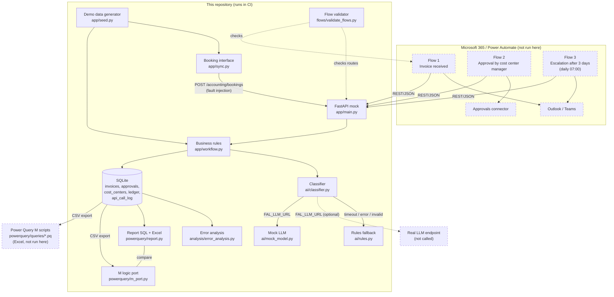
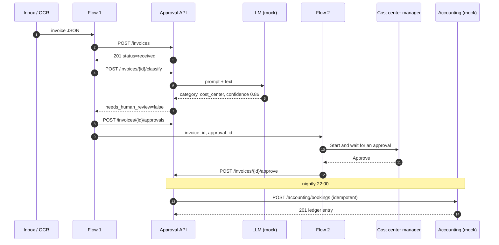

# Architecture

Dashed boxes are **not part of this repository** (they exist only as JSON
definitions or as documentation). Everything else runs in CI.

## Happy path

## Design decisions

* **Integer cents, naive UTC strings.** No float drift; ISO strings sort and export cleanly to CSV/Power Query.
* **Business rules outside the HTTP layer.** `app/workflow.py` takes an explicit `now`, so the demo
  generator replays a 3-month timeline through the same rules the API enforces, and tests can pin time.
* **Store every document.** Duplicates and invalid documents are kept with a status and reason instead of
  being rejected with 4xx, so the error analysis can count them and nothing is lost silently.
* **Idempotent booking.** One ledger entry per invoice. A retry after a lost response returns 200 instead
  of booking twice.
* **LLM behind a validated contract.** The model may only answer with known categories / cost centers and
  a confidence in 0..1; anything else is treated as a failure and the rules take over. A prompt injection
  in invoice text can therefore at most pick a wrong *valid* label; the confidence threshold and human
  review are the safety net (see README limits).
* **Determinism.** `random.Random(2026)` plus SHA-256 for all "random" behaviour (mock model jitter, fault
  injection). CI regenerates the report and the error analysis and fails if they differ from the commit.
