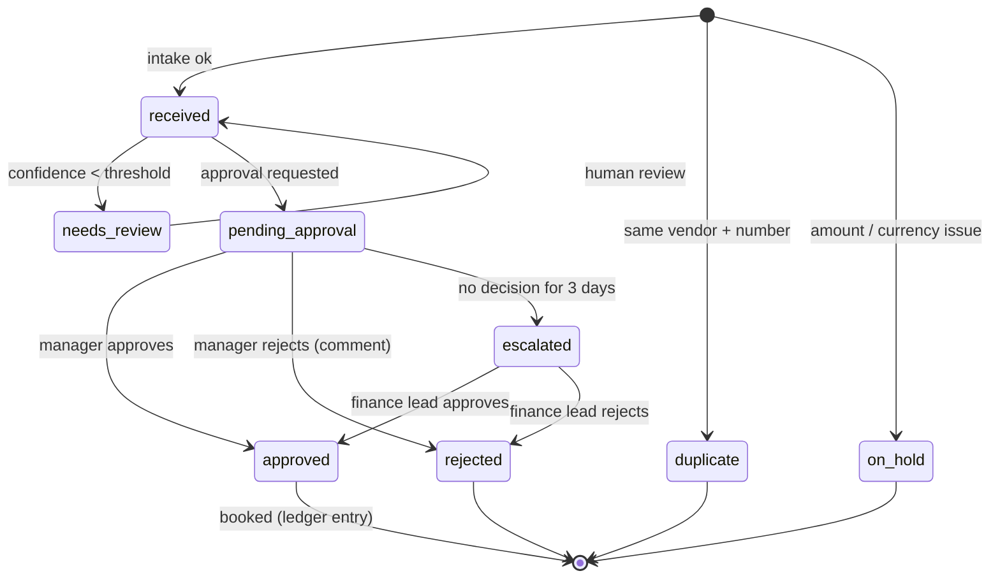

# Process: supplier invoice approval

Simulated process. Everything here is implemented in `app/workflow.py` and
exercised by the tests; the Power Automate flows in `flows/` describe the same
process for a Microsoft 365 tenant but are **not run** in this repository.

## Roles

| Role | Does | System |
|---|---|---|
| AP clerk (accounts payable) | Receives invoices, handles holds, duplicates and human reviews | AP mailbox, Teams channel |
| Cost center manager | Approves or rejects invoices of their cost center (level 1) | Approvals (Power Automate) |
| Finance lead | Decides escalated invoices (level 2) | Approvals (Power Automate) |
| IT / integration | Runs the API, the booking interface and the flows; reacts to alerts | IT ops mailbox |

## Steps

1. **Intake** (flow 1, `POST /invoices`). Every inbound document is stored, nothing is dropped.
   * same vendor + normalised invoice number already exists → status `duplicate`, AP is notified, flow stops
   * `net + tax != gross`, negative amount on an invoice, zero amount, non-EUR currency → `on_hold`, AP is notified, flow stops
   * otherwise → `received`
2. **AI classification** (`POST /invoices/{id}/classify`). The classifier proposes cost center and booking
   category with a confidence value. LLM first (configurable URL); on timeout, HTTP error or invalid answer
   the rule based fallback is used.
   * confidence `>=` threshold (default 0.75) → stays `received`, approval starts
   * confidence `<` threshold → `needs_review`; AP gets a Teams message and classifies by hand (`POST /invoices/{id}/review`)
3. **Approval** (flow 2). A level-1 approval is created for the manager of the cost center
   (`POST /invoices/{id}/approvals`, status `pending_approval`). Only the assigned approver may decide;
   a rejection needs a comment.
4. **Escalation** (flow 3, daily 07:00). A level-1 approval without decision for **3 × 24 hours** is set to
   `escalated` and a level-2 approval for the finance lead is created (invoice status `escalated`). The
   original manager can no longer decide (HTTP 403). Level 2 is not escalated further.
5. **Booking** (nightly 22:00, `app/sync.py`). Approved invoices are posted to the accounting system
   (`POST /accounting/bookings`). Retries on timeout / 5xx (3 attempts, 0 s / 30 s / 120 s); 4xx is not
   retried and the invoice is parked. The endpoint is idempotent per invoice.
6. **Monthly report** (Power Query, `powerquery/`). Open invoices, approval time, rejected items.

## Invoice status model

## Business rules (and where they are tested)

| Rule | Code | Tests |
|---|---|---|
| Invoice numbers are compared upper-case, without separators, without leading zeros | `normalize_invoice_number` | `test_workflow.py::test_invoice_number_normalisation_*` |
| `net + tax == gross`, no negative invoice, credit notes must be negative | `validate_amounts` | `test_workflow.py::test_*amount*`, `test_*credit_note*` |
| Duplicate = same vendor + normalised number, always points to the first original | `find_duplicate` | `test_workflow.py::test_*duplicate*` |
| Below the confidence threshold a human classifies | `classify_invoice` | `test_workflow.py::test_low_confidence_goes_to_human_review`, `test_classifier.py` |
| Only the assigned approver decides, case-insensitive e-mail | `decide` | `test_workflow.py::test_wrong_approver_is_forbidden` |
| Rejection needs a comment | `decide` | `test_workflow.py::test_rejection_requires_comment` |
| Escalation at exactly 72 h, not one second earlier, only once, only level 1 | `escalate` | `test_workflow.py::test_escalation_*` |
| Booking only for approved invoices, idempotent, not into a closed period | `book_invoice` | `test_workflow.py::test_booking_*`, `test_period_close_boundaries` |

## Assumptions

* Escalation counts calendar hours, not business days (simpler; a real tenant would likely use business days).
* Posting date = invoice date; month M closes on day 5 of month M+1. This is what causes the
  `period_closed` findings in the error analysis.
* One approval level per invoice (no amount-based four-eyes rule). Escalation adds the second level.
